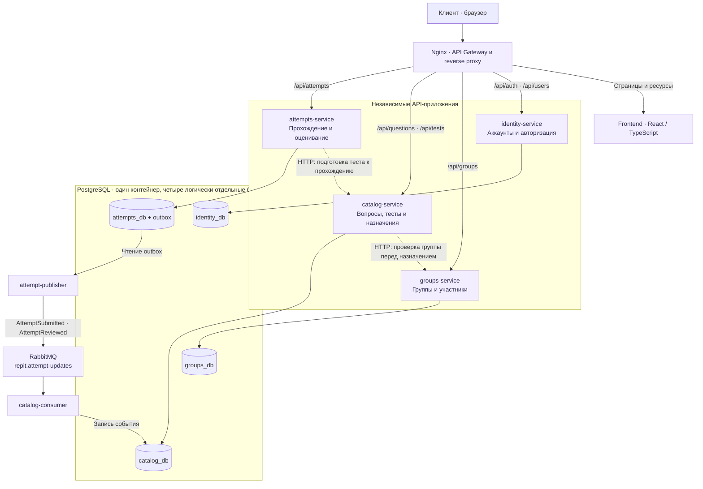

# РепИТ · версия 0.0

## Описание проекта

**РепИТ** — микросервисная система учебного тестирования. Преподаватель создаёт группы и приглашает учащихся, ведёт категории и банк вопросов, составляет тесты, назначает их и проверяет развёрнутые ответы. Учащийся вступает в группу по коду, проходит назначенный тест и получает результат.

Поддерживаются одиночный и множественный выбор, краткий и развёрнутый ответы, таймер, дедлайн, ограничение попыток и настройка видимости результатов. Первые три формата оцениваются автоматически, развёрнутый ответ — преподавателем. ИИ может подготовить вопрос или тест: результат открывается как редактируемый черновик и записывается только после явного сохранения.

Клиент написан на React и TypeScript, серверная часть — на FastAPI. PostgreSQL хранит данные, RabbitMQ передаёт события, Nginx обеспечивает публичную точку входа.

## Схема архитектуры

Структура соответствует схеме из задания: клиент → единая точка входа → независимые сервисы → собственные данные. Асинхронное взаимодействие вынесено в брокер сообщений.



Всего запускается **10 контейнеров**: Gateway, frontend, четыре API, PostgreSQL, RabbitMQ, издатель и потребитель событий. Каждой базе назначена отдельная роль. Бизнес-сервисы взаимодействуют по HTTP и событиям, без прямого чтения чужих таблиц.

**Синхронный сценарий:** перед назначением теста каталог запрашивает группы преподавателя и проверяет допустимость назначения.

**Асинхронный сценарий:** сервис попыток записывает результат и событие в outbox одной транзакцией. Издатель отправляет событие в RabbitMQ, потребитель сохраняет его в каталоге и подтверждает обработку. Уникальность идентификатора события и пары «попытка, ревизия» защищает от повторной доставки.

**Поток обновлений:** каталог предоставляет `GET /api/tests/{id}/events/` через SSE и Gateway. Интерфейс результатов получает данные через REST; SSE можно открыть отдельно для демонстрации.

## Запуск проекта

```bash
docker compose up -d --build --wait
```

Для ИИ задаются серверные `AI_API_KEY`, `AI_BASE_URL`, `AI_MODEL`, `AI_RESPONSE_FORMAT`. С пустым `AI_API_KEY` ручное создание и прохождение работают, а генерация сообщает об отсутствии настройки.